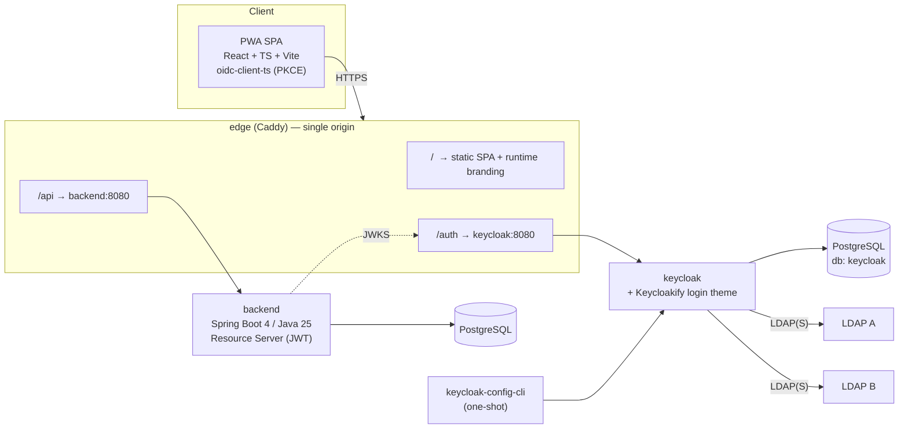

# Varco — Architecture

> **How** the system is built. Decisions and their rationale are in `docs/adr/`. Where this document and an ADR disagree, the ADR wins and this file must be fixed.

## 1. Component view



- **Single origin** (ADR-0003): browser only talks to `https://<host>`. `/auth` is Keycloak (`KC_HTTP_RELATIVE_PATH=/auth`), `/api` is the backend, everything else is the SPA. No CORS, first-party cookies only, the iOS standalone PWA keeps login inside its scope.
- One PostgreSQL server, two databases: `varco` (app) and `keycloak`.
- In dev/test, `ldap-a` and `ldap-b` are OpenLDAP containers seeded from LDIF. In production they are omitted and Keycloak points to the customer's directories (see § 8).

## 2. Repository layout (monorepo)

```
varco/
├── AGENTS.md                  # rules for coding agents (read first)
├── Makefile                   # single entry point: make up | check | e2e | ...
├── compose.yaml               # image-only stack (used by repo and dist)
├── compose.build.yaml         # build contexts overlay (from source)
├── compose.{demo,prod,tunnel,e2e}.yaml  # overlays
├── docker-bake.hcl            # self-build of images (buildx)
├── dist/                      # `varco` CLI + dist packaging (release asset)
├── .devcontainer/             # GitHub Codespaces "try it"
├── website/                   # VitePress docs site → GitHub Pages (ADR-0012)
├── .env.example
├── branding/                  # default brand assets (mounted at runtime)
├── api/openapi.yaml           # REST contract — source of truth (ADR-0005)
├── backend/                   # Spring Boot (Maven wrapper)
│   └── src/main/java/dev/varco/
│       ├── VarcoApplication.java
│       ├── shared/            # security, errors, clock, ids, web config (foundation-owned)
│       ├── identity/          # users, memberships, admin flag, provisioning
│       ├── office/            # offices
│       ├── presence/          # events, current presence, corrections, auto-close, live view
│       ├── planning/          # plans
│       └── audit/             # audit log, CSV export, retention
├── frontend/                  # PWA (pnpm workspace member)
│   └── src/
│       ├── app/               # shell, router, auth, api client, layout (foundation-owned)
│       ├── ui/                # design-system components (foundation-owned)
│       └── features/
│           ├── today/  plan/  history/  office-shell/  office-live/
│           └── admin/  audit/  profile/
├── packages/brand/            # design tokens + runtime theme generator (shared by frontend & login theme)
├── keycloak-theme/            # Keycloakify login theme (pnpm workspace member)
├── infra/
│   ├── edge/                  # Caddyfile, Dockerfile (builds SPA)
│   ├── keycloak/              # Dockerfile (bakes theme jar), config-cli YAML (realm, ldap-a, ldap-b)
│   ├── ldap/ldap-a|ldap-b/    # seed LDIF (test only)
│   └── postgres/init/         # create databases/users
├── e2e/                       # Playwright
├── scripts/                   # trace.sh, create-issues.sh, wait-for-stack.sh
├── tests/manual/              # manual test scripts (release baptism)
├── .claude/  .githooks/       # agent guardrails (no attribution, no push to main)
└── docs/                      # SPEC, ARCHITECTURE, DESIGN, adr/ (durable docs only — work lives in issues)
```

## 3. Authentication flow (ADR-0002)

1. SPA (public client `varco-spa`) starts Authorization Code flow with **PKCE S256** via `oidc-client-ts` → `/auth/realms/varco/protocol/openid-connect/auth`.
2. Keycloak authenticates against the LDAP federation (read-only), redirects to `/auth/callback?code=…`.
3. SPA exchanges the code at the token endpoint **directly** (no backend relay, no server session).
4. Tokens are kept **in memory only** (`userStore: InMemoryWebStorage`). Access token TTL 5 min; refresh tokens rotate (`revokeRefreshToken=true`, reuse 0).
5. On page load / PWA relaunch, the SPA performs a **top-level redirect with `prompt=none`**; the Keycloak SSO cookie (first-party, same origin) yields a new code silently. "Ricordami" extends the SSO cookie (remember-me max 30 days, configurable). No iframe-based silent renew.
6. API calls send `Authorization: Bearer`. Backend validates signature (JWKS from `http://keycloak:8080/auth/realms/varco` internally), `iss` = public issuer URL, `aud` contains `varco-api` (audience mapper on client scope), `exp`.

Issuer subtlety: the token `iss` is the **public** URL (`https://<host>/auth/realms/varco`) while the backend fetches JWKS over the internal network. Configure `spring.security.oauth2.resourceserver.jwt.jwk-set-uri` (internal) **and** validate `iss` against `VARCO_PUBLIC_URL` explicitly; set Keycloak `KC_HOSTNAME=https://<host>/auth` so issuer is stable.

Logout: RP-initiated logout (`end_session_endpoint` with `id_token_hint`, `post_logout_redirect_uri=/`).

Keycloak realm (managed by keycloak-config-cli, ADR-0006):
- Realm `varco`, default locale `it`, supported locales `it`, login theme `varco`, `rememberMe=true`, brute-force detection on.
- Client `varco-spa`: public, standard flow only, PKCE required (`pkce.code.challenge.method=S256`), redirect URIs `${VARCO_PUBLIC_URL}/*`, web origins `+`, post-logout redirect `${VARCO_PUBLIC_URL}/*`, consent off, client scope `varco-api-audience` (audience mapper `varco-api`).
- Client `varco-e2e` (**dev/test only file**): confidential, direct access grants, used by API tests and E2E setup to obtain tokens. Never present in `compose.prod.yaml`.
- Tokens: access 5 min, SSO idle 30 min, SSO max 10 h, remember-me idle/max 30 days (env-configurable).
- User federation `ldap-a`, `ldap-b`: `editMode=READ_ONLY`, `importEnabled=true`, `syncRegistrations=false`, periodic changed-users sync 1 h, mappers: username←`uid` (AD: `sAMAccountName`), firstName←`givenName`, lastName←`sn`, email←`mail`. Connection URL, bind DN/credential, users DN, user object classes, username attribute, `startTls`/ldaps and truststore all from env.

## 4. Backend

- **Java 25 LTS, Spring Boot 4.x (latest GA at scaffold time), Maven wrapper** (ADR-0010). Note Boot 4 ships Jackson 3 (`tools.jackson.*` packages) and Spring Security 7.
- Starters: web (MVC, virtual threads on), validation, data-jpa, oauth2-resource-server, actuator, flyway + `flyway-database-postgresql`, Spring Modulith (core, JPA event publication, test).
- **Modulith modules** = top-level packages `identity`, `office`, `presence`, `planning`, `audit`; `shared` is an *open* module. Cross-module calls only through each module's public API package (`dev.varco.<module>` root types) or **domain events** (`dev.varco.<module>.events.*`). `ApplicationModules.verify()` runs in `make check`.
- **Authorization**: method security with a single bean `@authz` (`shared.security.Authz`) exposing `isAdmin()`, `isMember(officeId)`, `isOfficeAdmin(officeId)`, `canManageOffice(officeId)`. Controllers use `@PreAuthorize("@authz.isOfficeAdmin(#officeId)")`. `Authz` reads a request-scoped `CurrentUser` resolved once per request by a filter (JIT provisioning, BR-01) through an `identity` API interface.
- **Errors**: RFC 9457 Problem Details with extension `code` (e.g. `PRESENCE_ALREADY_IN`) and `fieldErrors[]`. Codes are an enum mirrored in `api/openapi.yaml`; the SPA maps codes to Italian text.
- **Time**: inject `java.time.Clock` everywhere (tests use a mutable test clock). Scheduled jobs (auto-close every minute, retention nightly 02:30 Europe/Rome) use `@Scheduled` + ShedLock (JDBC) so multiple backend replicas are safe.
- **Concurrency**: presence commands lock the user row (`SELECT … FOR UPDATE` on `app_user`) to serialise one user's events; `current_presence` updated in the same transaction.
- **Persistence**: JPA for aggregates; read models (live view, logs, timeline) via `JdbcClient` SQL. Flyway migrations in `backend/src/main/resources/db/migration`.
- **API docs**: springdoc serves `/api/docs` (dev profile only). Contract conformance test validates responses of integration tests against `api/openapi.yaml` (Atlassian `swagger-request-validator` MockMvc integration; if incompatible with Boot 4, use `openapi4j`/`networknt json-schema-validator` on recorded responses — document the choice in the PR).
- **Profiles**: `dev` (demo seed, springdoc), `test`, `prod`.
- **Demo seed** (`dev` profile, idempotent `ApplicationRunner`): offices PAD (Padova, capacity 40, 08:00–19:00) and MIL (Milano, **no capacity** — exercises the optional path); pre-provisioned users and roles matching the LDAP seeds (§ 7).

### 4.1 Data model (Flyway `V1__baseline.sql`, owned by T03)

```sql
create table office (
  id uuid primary key,
  code varchar(16) not null,
  name varchar(120) not null,
  address varchar(255),
  timezone varchar(64) not null default 'Europe/Rome',
  capacity integer check (capacity is null or capacity > 0),
  open_time time not null default '08:00',
  close_time time not null default '19:00',
  auto_close_time time not null default '21:00',
  archived_at timestamptz,
  created_at timestamptz not null,
  updated_at timestamptz not null,
  version bigint not null default 0,
  check (open_time < close_time)
);
create unique index ux_office_code on office (lower(code));

create table app_user (
  id uuid primary key,
  username varchar(64) not null unique,          -- lower-cased
  keycloak_sub varchar(64) unique,
  display_name varchar(200),
  email varchar(255),
  is_admin boolean not null default false,
  active boolean not null default true,
  primary_office_id uuid references office(id),
  last_login_at timestamptz,
  created_at timestamptz not null,
  updated_at timestamptz not null,
  version bigint not null default 0
);

create table office_membership (
  user_id uuid not null references app_user(id),
  office_id uuid not null references office(id),
  role varchar(16) not null check (role in ('MEMBER','OFFICE_ADMIN')),
  created_at timestamptz not null,
  created_by uuid references app_user(id),
  primary key (user_id, office_id)
);
create index ix_membership_office on office_membership (office_id, role);

create table presence_event (
  id uuid primary key,
  user_id uuid not null references app_user(id),
  office_id uuid not null references office(id),
  type varchar(8) not null check (type in ('ENTER','EXIT')),
  occurred_at timestamptz not null,
  recorded_at timestamptz not null,
  source varchar(16) not null check (source in ('APP','CORRECTION','AUTO_CLOSE','AUTO_SWITCH')),
  recorded_by uuid references app_user(id),     -- null = system
  client_event_id uuid,
  pair_id uuid,                                 -- links ENTER/EXIT of one visit
  note varchar(500),
  voided_at timestamptz,
  voided_by uuid references app_user(id),
  unique (user_id, client_event_id)
);
create index ix_event_office_time on presence_event (office_id, occurred_at desc);
create index ix_event_user_time on presence_event (user_id, occurred_at desc);

create table current_presence (
  user_id uuid primary key references app_user(id),
  office_id uuid not null references office(id),
  since timestamptz not null,
  enter_event_id uuid not null references presence_event(id)
);
create index ix_current_office on current_presence (office_id);

create table presence_plan (
  id uuid primary key,
  user_id uuid not null references app_user(id),
  office_id uuid not null references office(id),
  plan_date date not null,
  expected_arrival time,
  expected_exit time,
  note varchar(300),
  created_at timestamptz not null,
  updated_at timestamptz not null,
  unique (user_id, plan_date),
  check (expected_arrival is null or expected_exit is null or expected_arrival < expected_exit)
);
create index ix_plan_office_date on presence_plan (office_id, plan_date);

create table audit_entry (
  id uuid primary key,
  occurred_at timestamptz not null,
  actor_id uuid references app_user(id),        -- null = system
  action varchar(48) not null,
  office_id uuid references office(id),
  subject_user_id uuid references app_user(id),
  details jsonb not null default '{}'::jsonb
);
create index ix_audit_time on audit_entry (occurred_at desc);
create index ix_audit_office_time on audit_entry (office_id, occurred_at desc);

-- plus: Spring Modulith event_publication table, ShedLock table (copy official DDL)
```

**Migration numbering** (prevents collisions between parallel agents): `V1__baseline.sql` by T03; afterwards each module uses its own range — identity `V1_1xx`, office `V1_2xx`, presence `V1_3xx`, planning `V1_4xx`, audit `V1_5xx` (e.g. `V1_301__presence_extra_index.sql`). `spring.flyway.out-of-order=false`; ranges are monotonic per module and merged in order of PR merge — if Flyway complains, rebase and renumber within your range.

### 4.2 Domain events (published via Spring Modulith, consumed by `audit` and others)

Defined in T03 as Java records so producers and the audit consumer can be built in parallel:
`OfficeCreated/Updated/Archived`, `MembershipChanged(userId, officeId, oldRole, newRole)` (null = none), `AdminFlagChanged`, `UserActivationChanged`, `UserProvisioned`, `PresenceRecorded(eventId, source, …)`, `PresenceVoided`, `PresenceCorrected`, `RetentionPurged`. Each carries `actorId` (nullable), `occurredAt`, and a `details` map for before/after.

`office` → `presence`/`planning`: on `OfficeArchived`, presence closes open presences and planning deletes future plans (BR-18). `identity` → `planning`: on `MembershipChanged` to none, delete future plans (BR-23). `identity` → `presence`: on deactivation close presence (BR-04).

## 5. REST API overview (contract: `api/openapi.yaml`)

All under `/api`, JSON, bearer auth, Problem Details errors, cursor-less offset pagination (`page`, `size≤100`, response `{items,total,page,size}`), ISO-8601 instants, `LocalTime` as `HH:mm`.

| Method & path | Who | Purpose |
|---|---|---|
| `GET /me` | any | profile, `isAdmin`, `active`, memberships `[{office, role}]`, `currentPresence`, `todayPlan`, `primaryOfficeId` |
| `PATCH /me` | any | set `primaryOfficeId` |
| `POST /me/presence/events` | member | `{type, officeId?, occurredAt?, clientEventId}` → `201` (or `200` replay) |
| `DELETE /me/presence/events/{id}` | owner | undo within 2 min |
| `GET /me/presence/events?from&to&page` | any | own history (incl. voided flag, source) |
| `PUT /me/presence/planned-exit` | present member | `{time}` / `DELETE` clears |
| `GET /me/plans?from&to` · `PUT /me/plans/{date}` · `DELETE /me/plans/{date}` | member | own plans (upsert by date) |
| `GET /offices?includeArchived` | any | admin: all; others: offices where member (minimal) |
| `POST /offices` | admin | create |
| `GET /offices/{id}` · `PATCH /offices/{id}` | referente/admin | details / edit (code: admin only) |
| `POST /offices/{id}/archive` | admin | archive |
| `GET /offices/{id}/live` | referente/admin | count, capacity + capacity status (both nullable), present list (+planned exit, role), expected today, coverage now, coverage timeline |
| `GET /offices/{id}/members` · `PUT /offices/{id}/members/{userId}` `{role}` · `DELETE …` | referente/admin | membership mgmt |
| `GET /offices/{id}/events?from&to&userId&type&source&includeVoided&page` | referente/admin | presence log |
| `GET /offices/{id}/events.csv?…` | referente/admin | CSV export (same filters) |
| `POST /offices/{id}/corrections` | referente/admin | `{kind: CLOSE_OPEN|ADD_VISIT|VOID_VISIT, userId, …, note}` |
| `GET /offices/{id}/plans?from&to` | referente/admin | plans in office |
| `GET /users?q&officeId&page` | referente/admin | search (referente: minimal fields, any user) |
| `POST /users` | referente/admin | pre-provision `{username, displayName?}` |
| `PATCH /users/{id}` | admin | `{isAdmin?, active?}` |
| `GET /audit?officeId&actorId&subjectUserId&action&from&to&page` | referente (own offices)/admin | admin audit log |

Live updates: the SPA polls `/offices/{id}/live` every 15 s while visible (TanStack Query `refetchInterval`, paused when hidden) and refetches on window focus. SSE is a documented future option.

## 6. Frontend

- React 19, TypeScript `strict`, Vite, `vite-plugin-pwa` (generateSW, `registerType: 'prompt'` with an in-app "Nuova versione disponibile" toast), React Router (data mode), TanStack Query, `oidc-client-ts` + `react-oidc-context`, `openapi-typescript` + `openapi-fetch` (types generated from `api/openapi.yaml` → `frontend/src/app/api/schema.d.ts`, never hand-edited), `react-hook-form` + `zod`.
- UI primitives: **React Aria Components** (accessible, unstyled, it-IT date/time handling) styled with **CSS Modules + design tokens** from `packages/brand`. Icons: Phosphor. Fonts self-hosted via Fontsource. No Tailwind, no component kit with a recognisable default look (ADR-0009, DESIGN.md).
- Messages: one typed catalog per feature (`features/<f>/messages.it.ts`) + `app/messages.it.ts`; ESLint `no-literal-string` in JSX for `src/features` and `src/ui`. Error `code` → message map in `app/errors.it.ts`.
- Offline: service worker precaches the shell; `/api/me` cached (NetworkFirst, 5 s timeout) for last-known status; presence commands go through an **outbox** in IndexedDB (`idb-keyval`) holding *commands only, never tokens*; flushed on `online`, on focus and after login; each entry keeps `clientEventId` + `occurredAt`.
- Routing: `/` (Oggi), `/pianifica`, `/storico`, `/sede/:officeId` (+ tabs *Ora*, *Registro*, *Pianificazioni*, *Persone*), `/admin/sedi`, `/admin/utenti`, `/admin/audit`, `/profilo`, `/auth/callback`. Role-gated routes hidden from navigation and guarded.
- Tests: Vitest + Testing Library + MSW (handlers typed from the OpenAPI schema), `vitest-axe`.

## 7. Test identities (dev/test only)

| Directory | Base DN | Username | Password | App role (demo seed) |
|---|---|---|---|---|
| ldap-a | `dc=sede-a,dc=varco,dc=test` | `admin.varco` | `Varco!2026` | ADMIN (bootstrap), member PAD |
| ldap-a | | `giulia.bianchi` | `Varco!2026` | OFFICE_ADMIN PAD |
| ldap-a | | `marco.ferri` | `Varco!2026` | OFFICE_ADMIN PAD |
| ldap-a | | `mario.rossi` | `Varco!2026` | MEMBER PAD, MEMBER MIL |
| ldap-a | | `elena.galli` | `Varco!2026` | no membership |
| ldap-b | `dc=sede-b,dc=varco,dc=test` | `luca.verdi` | `Varco!2026` | not pre-seeded (AC-41) |
| ldap-b | | `sara.neri` | `Varco!2026` | OFFICE_ADMIN MIL |
| ldap-b | | `paolo.conti` | `Varco!2026` | MEMBER MIL |
| ldap-b | | `disattivato.test` | `Varco!2026` | MEMBER MIL, `active=false` |

Plus ~40 generated members per office (`utente01…`) in LDIF for realistic lists. These credentials are **public test data** and must be labelled as such in the LDIF and README.

## 8. Configuration (env, see `.env.example`)

| Variable | Default (dev) | Used by |
|---|---|---|
| `VARCO_PUBLIC_URL` | `https://localhost:8443` | edge, keycloak, backend, SPA config |
| `VARCO_BOOTSTRAP_ADMINS` | `admin.varco` | backend |
| `VARCO_RETENTION_MONTHS` / `VARCO_AUDIT_RETENTION_MONTHS` | `24` / `60` | backend |
| `VARCO_BRAND_NAME`, `VARCO_BRAND_SHORT_NAME`, `VARCO_BRAND_PRIMARY`, `VARCO_BRAND_ACCENT`, `VARCO_BRAND_RADIUS` (`sharp`/`soft`/`round`) | Varco defaults | edge (SPA config + manifest), keycloak theme |
| `branding/` volume: `logo.svg`, `logo-dark.svg`, `icon-192.png`, `icon-512.png`, `icon-maskable-512.png`, `favicon.svg` | bundled defaults | edge, keycloak |
| `LDAP_A_URL`, `LDAP_A_BIND_DN`, `LDAP_A_BIND_PASSWORD`, `LDAP_A_USERS_DN`, `LDAP_A_USERNAME_ATTR`, `LDAP_A_USER_OBJECT_CLASSES`, `LDAP_A_VENDOR` (`other`/`ad`), `LDAP_A_START_TLS` | test container | keycloak-config-cli |
| same for `LDAP_B_*`; `VARCO_LDAP_FILES` selects which LDAP config files are imported | `ldap-a,ldap-b` | keycloak-config-cli |
| `KC_ADMIN`, `KC_ADMIN_PASSWORD`, `POSTGRES_*`, `KC_DB_PASSWORD`, `VARCO_DB_PASSWORD` | placeholders | infra |
| `KC_TRUSTSTORE_PATHS` | – | keycloak (corporate CA for LDAPS) |
| `KC_REMEMBER_ME_DAYS` | `30` | keycloak-config-cli |

**Runtime branding** (ADR-0009): Caddy `templates` render `/config.json` and `/manifest.webmanifest` from env; `/branding/*` is served from the mounted folder. The SPA fetches `/config.json` before first render and applies the generated theme (`packages/brand` → CSS custom properties). The Keycloakify theme reads the same variables via Keycloak theme properties / `environmentVariables`, and loads the logo from `/branding/logo.svg` (same origin).

## 9. Deployment

See ADR-0014 for releases, images, the dist package and the zero-cost deployment paths; adopter-facing guides live on the docs site.


- `compose.yaml` — everything incl. test LDAPs, Caddy with `tls internal` on `https://localhost:8443`. For phone testing on the LAN: set `VARCO_PUBLIC_URL=https://<lan-ip>.sslip.io:8443` and trust Caddy's local root CA on the phone, or use a tunnel (documented in README).
- `compose.prod.yaml` — overlay: removes `ldap-a/ldap-b/varco-e2e client`, Caddy ACME on real domain, Keycloak `start --optimized` with `KC_PROXY_HEADERS=xforwarded`, secrets via Docker secrets or env files outside the repo, Postgres volume + nightly `pg_dump` sidecar.
- Images: multi-arch (amd64/arm64), attested, on GHCR (`X.Y.Z`, `X.Y`, `X`, `latest`, `edge`); `compose.yaml` references `${VARCO_VERSION:-dev}`; `make up` adds `compose.build.yaml` to build from source.
